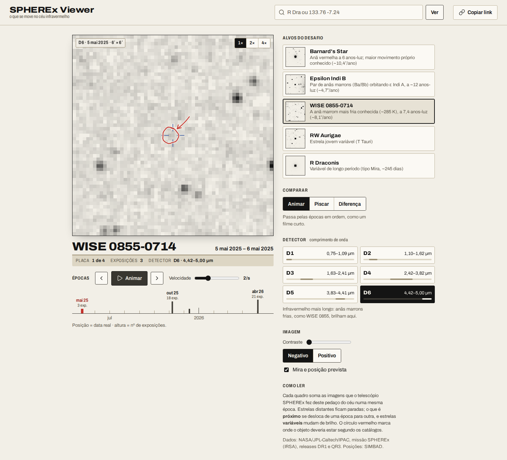
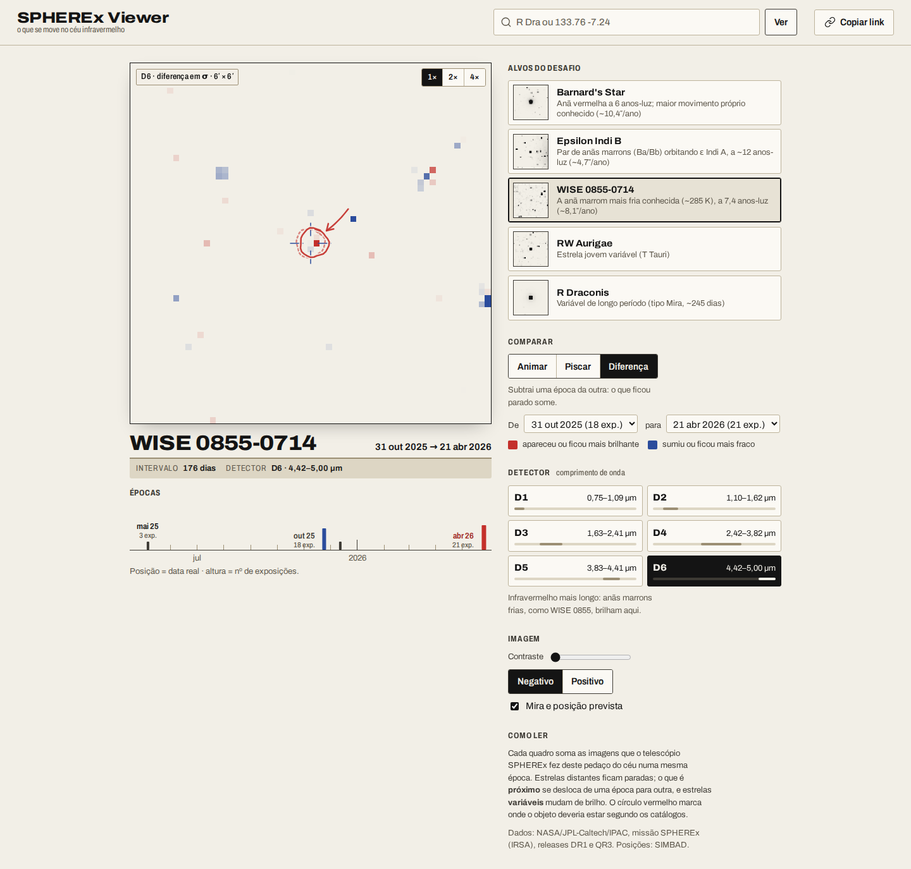
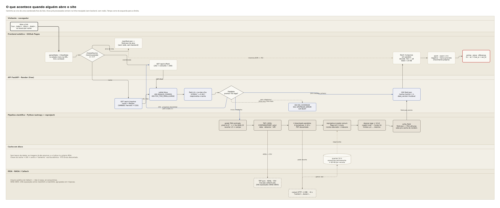
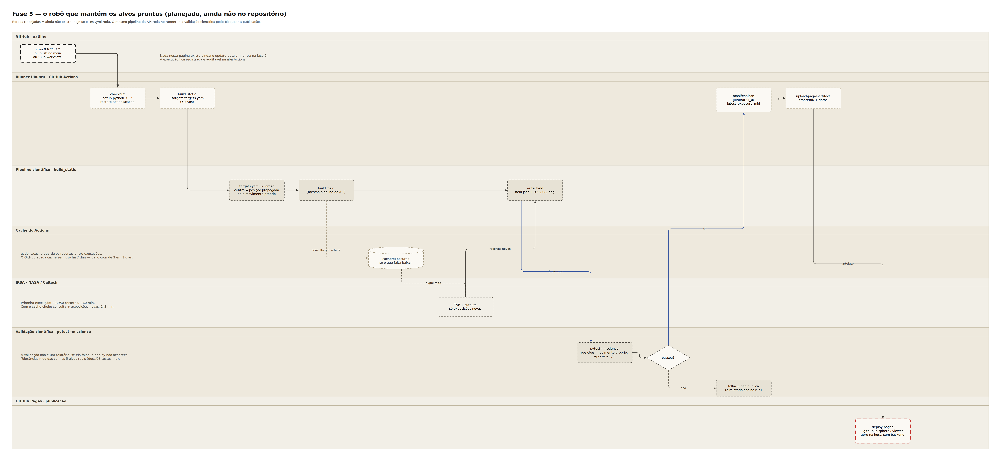

# SPHEREx Viewer

**Veja o que se move no céu infravermelho do telescópio SPHEREx, época por época.**

Projeto do [NASA Space Apps Challenge 2026](https://www.spaceappschallenge.org/2026/), desafio **Planet X and SPHEREx**.



O SPHEREx (NASA) mapeia o céu inteiro a cada seis meses em 102 bandas do infravermelho. Estrelas distantes ficam paradas de um mapeamento para o outro; o que está **perto** se desloca, e estrelas **variáveis** mudam de brilho. Foi comparando duas placas fotográficas assim que Clyde Tombaugh achou Plutão em 1930.

O SPHEREx Viewer faz essa comparação com dados reais da missão: você escolhe um pedaço do céu e vê as imagens daquele ponto em sequência, como um filme curto.

## O que ele faz

| | |
|---|---|
| **Animar** | Passa pelas épocas em ordem |
| **Piscar** | Alterna entre duas épocas, como o comparador de Tombaugh |
| **Diferença** | Subtrai uma época da outra, em unidades de ruído: o céu parado some e sobra o que mudou |
| **Detectores D1–D6** | De 0,75 a 5,0 µm. Uma anã marrom fria como WISE 0855 só aparece nos comprimentos de onda longos |
| **Mira e posição prevista** | Mira fixa no centro e círculo de lápis onde o catálogo diz que o objeto deveria estar |
| **Régua do tempo** | Cada época na sua data real, com o número de exposições |
| **Link compartilhável** | Todo o estado fica na URL (`?target=wise0855&mode=diff`), com modo `embed=1` para iframe |



*Diferença entre out/2025 e abr/2026 no campo do WISE 0855. Vermelho: apareceu ou ficou mais brilhante. Azul: sumiu ou ficou mais fraco.*

## Resultados com dados reais

Os cinco alvos de teste do desafio passam numa validação científica automática (`pytest -m science`), que compara o que o pipeline mede com valores independentes do SIMBAD e do Gaia.

| Alvo | O que a ferramenta mostra |
|---|---|
| **WISE 0855** | Anã marrom a ~285 K: só aparece em 4–5 µm, na posição prevista (erro de 0,12–0,19 px) |
| **Barnard's Star** | Desloca-se ~11″ para o norte em um ano, medido com erro de ~0,02 px |
| **Epsilon Indi B** | Detectado com sinal/ruído de 250 a 640; o movimento confere |
| **RW Aurigae** | Brilho sobe 1,35× entre épocas (12σ) |
| **R Draconis** | Brilho cai para 0,46× entre épocas (15σ) |
| Estrelas de campo | Ficam paradas entre épocas (0,02–0,04 px): o alinhamento é ~25× melhor que um pixel |

Um pixel do SPHEREx tem 6,15″. Detalhes, imagens e limitações em [docs/08-resultados.md](docs/08-resultados.md).

## Como funciona

Os alvos do desafio são pré-processados e publicados como arquivos estáticos, então abrem na hora. Para qualquer outra coordenada, uma API processa o campo sob demanda.

```
Navegador ──▶ Site estático (GitHub Pages) ──▶ dados dos alvos (field.json + quadros)
                      │
                      └─ coordenada fora da lista ──▶ API (FastAPI) ──▶ IRSA / NASA
```

O pipeline consulta o arquivo da NASA (IRSA), baixa o recorte de cada exposição, subtrai a luz zodiacal, descarta pixels com defeito, alinha tudo numa grade comum e soma as exposições de cada época. O navegador recebe os quadros como números e faz o contraste, o piscar e a diferença localmente.

### Consulta ao vivo

Do link no navegador até o pixel na tela, com o que acontece em cada camada e nos casos de falha.

[](docs/diagramas/01-consulta-ao-vivo.png)

### Atualização agendada

O fluxo que vai manter os alvos atualizados: pipeline, validação científica e publicação. Se a validação falha, o site não é publicado. **As bordas tracejadas indicam o que ainda não existe** (fase 5).

[](docs/diagramas/02-atualizacao-agendada.png)

Os diagramas são grandes: clique para abrir em tamanho real. A legenda, os números de referência e o arquivo editável (`.drawio`) estão em [docs/diagramas/](docs/diagramas/README.md).

## Rodar localmente

Requisitos: [uv](https://docs.astral.sh/uv/) e Node.js 22.

```bash
# 1. Gerar os dados dos alvos (baixa do IRSA: ~60 min na primeira vez, ~2,5 min com cache)
cd backend
uv sync
uv run python -m pipeline.build_static --out ../frontend/public/data

# 2. Abrir o site
cd ../frontend
npm install
npm run dev          # http://localhost:5173
```

Para consultar coordenadas e nomes fora da lista de alvos, suba a API e aponte o site para ela:

```bash
cd backend && uv run uvicorn api.main:app --port 8000
cd frontend && VITE_API_BASE=http://127.0.0.1:8000 npm run dev
```

### Testes

```bash
cd backend
uv run pytest               # 67 testes rápidos, sem rede
uv run pytest -m science    # 16 testes com dados reais dos 5 alvos
uv run pytest -m live       # 8 testes contra o SIMBAD

cd frontend
npm test                    # 32 testes do núcleo do site
```

O guia completo está em [docs/10-desenvolvimento.md](docs/10-desenvolvimento.md).

## Estrutura

```
backend/
  pipeline/    ciência: consulta ao IRSA, cache, alinhamento, soma por época, gravação
  api/         API FastAPI: campo sob demanda, arquivos do campo, resolução de nomes
  tests/       testes por fronteira, respostas reais gravadas e validação científica
frontend/
  src/core/    lógica pura e testada: quadros, contraste, diferença, coordenadas, URL
  src/         interface: controlador, carregamento de dados, estilos
schemas/       contrato de dados entre backend e frontend (JSON Schema)
targets.yaml   os alvos pré-processados (posição e movimento próprio do SIMBAD)
docs/          documentação e diagramas
```

Tecnologias: Python 3.12, Astropy, reproject, FastAPI, TypeScript, Vite, Vitest.

## Situação

| Fase | Entrega | Estado |
|---|---|---|
| 1 | Pipeline científico com céu sintético | ✅ |
| 2 | Dados reais do IRSA e validação científica dos 5 alvos | ✅ |
| 3 | Contrato de dados, dados estáticos e API | ✅ |
| 4 | Site | ✅ |
| 5 | Publicação: GitHub Pages, API no Render, atualização automática | Pendente |
| 6 | Extras: espectro sob demanda, catálogos Gaia/WISE, falsa cor | Pendente |

O site ainda não tem endereço público; por enquanto roda localmente.

## Documentação

| Documento | Conteúdo |
|---|---|
| [01-projeto](docs/01-projeto.md) | O desafio, os objetivos e os alvos de teste |
| [02-dados-spherex](docs/02-dados-spherex.md) | Os dados da missão e como acessá-los |
| [03-arquitetura](docs/03-arquitetura.md) | O processamento passo a passo e as decisões de implementação |
| [04-api](docs/04-api.md) | A API, o formato dos dados e os parâmetros da URL |
| [05-hospedagem](docs/05-hospedagem.md) | Hospedagem gratuita e atualização automática |
| [06-testes](docs/06-testes.md) | Estratégia de testes e critérios científicos |
| [07-plano-desenvolvimento](docs/07-plano-desenvolvimento.md) | Fases, marcos e fluxo de git |
| [08-resultados](docs/08-resultados.md) | Resultados com dados reais |
| [09-relatorio-progresso](docs/09-relatorio-progresso.md) | Relatório consolidado: decisões e problemas resolvidos |
| [10-desenvolvimento](docs/10-desenvolvimento.md) | Como rodar e testar |
| [diagramas](docs/diagramas/README.md) | Fluxo do sistema em diagramas de raia |
| [PRODUCT.md](PRODUCT.md) · [DESIGN.md](DESIGN.md) | Registro do produto e do sistema visual |

## Créditos

Dados: NASA/JPL-Caltech/IPAC, missão SPHEREx, obtidos pelo [IRSA](https://irsa.ipac.caltech.edu/Missions/spherex.html) (releases DR1 e QR3). Posições e movimentos próprios: [SIMBAD](https://simbad.cds.unistra.fr/simbad/) (CDS, Estrasburgo) e Gaia DR3.

Este projeto não é afiliado à NASA nem endossado por ela.
