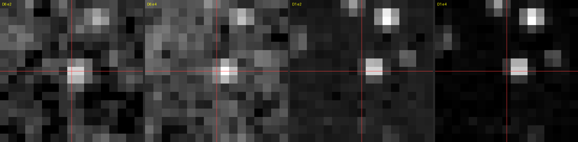
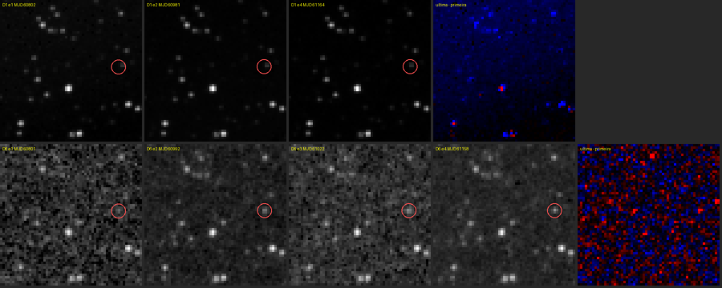

# Resultados

Resultados obtidos com **dados reais** do SPHEREx durante o desenvolvimento. Serve de registro científico do projeto e de material para a apresentação.

## Resumo: os 5 alvos do desafio (14/11/2026)

Todos validados automaticamente por `pytest -m science` (16 testes, ~2,5 min com o cache cheio).

| Alvo | Exposições / épocas | Detector | Resultado |
|---|---|---|---|
| **WISE 0855** | 258 / 4 | D6 | Aparece só em 4–5 µm, na posição prevista (0,12–0,19 px); move 0,6 px entre nov/2025 e mai/2026 (erro 0,09 px) |
| **Barnard's Star** | 358 / 7 | D2 | Move **1,81 px (~11″) para o norte** entre ago/2025 e set/2026 (erro ~0,02 px), apesar do núcleo saturado |
| **Epsilon Indi B** | 457 / 6 (1 exposição indisponível, pulada) | D2 | Detectado com S/R 250–640; posição 0,07–0,17 px; movimento confere |
| **RW Aurigae** | 335 / 3 | D2 | Brilho sobe **1,35×** entre épocas, a 12σ da dispersão das estrelas de campo |
| **R Draconis** | 537 / 8 (2 indisponíveis) | D2 | Brilho cai para **0,46×** (~0,85 mag), a 15σ: a variação de uma Mira |
| Estrelas de campo | 5 campos | D2 | Paradas entre épocas (0,02–0,04 px): alinhamento ~25× melhor que um pixel |

## Marco 1 — WISE 0855 real andando (14/11/2026)

### Configuração

| Item | Valor |
|---|---|
| Campo | RA 133,79513°, Dec −7,24515° (coordenada do desafio), 6′ × 6′ (59 × 59 px) |
| Dados | `spherex_dr1`, 258 exposições, nenhuma falhou |
| Processamento | ~5 min com 4 downloads simultâneos (o IRSA respondeu `503` várias vezes; resolvido com novas tentativas) |
| Posição prevista | SIMBAD (J2000) propagada pelo movimento próprio: μα* = −8123,7 mas/ano, μδ = +673,2 mas/ano |

Épocas encontradas (exposições por detector):

| Época | Início | D1 | D2 | D3 | D4 | D5 | D6 |
|---|---|---|---|---|---|---|---|
| 1 | 05/05/2025 | 4 | 8 | 3 | 4 | 8 | 3 |
| 2 | 31/10/2025 | 18 | 19 | 18 | 18 | 19 | 18 |
| 3 | 11/12/2025 | — | 6 | 3 | — | 6 | 3 |
| 4 | 21/04/2026 | 14 | 15 | 21 | 14 | 15 | 21 |

### Astrometria em D6 (4,4–5,0 µm)

Centroide medido no quadro × posição prevista pelo movimento próprio:

| Época | MJD médio | Erro | Erro (px) | Sinal/ruído do pico |
|---|---|---|---|---|
| 1 | 60800,7 | 1,7″ | 0,28 | 2,4 |
| 2 | 60991,5 | 0,8″ | 0,13 | 9,6 |
| 3 | 61021,6 | 0,8″ | 0,13 | 6,1 |
| 4 | 61157,9 | 1,8″ | 0,29 | 18,9 |

- Deslocamento entre as épocas 1 e 4: **1,07 px medido × 1,29 px previsto** (~8″ em ~1 ano).
- Nos detectores D1–D4 o WISE 0855 **não aparece**, como esperado para um objeto a ~285 K, que só emite no infravermelho mais longo.
- Uma **estrela de fundo** a ~1,8 px do WISE 0855 aparece em D1–D4 e fica **parada** entre as épocas (variação ≤ 0,3 px). É a prova do alinhamento com dados reais.

*Zoom 17 × 17 px. Da esquerda para a direita: D6 época 2, D6 época 4, D1 época 2, D1 época 4. Mira vermelha fixa no mesmo pixel.*

Animação em D6: [`img/marco1-wise0855-D6.gif`](img/marco1-wise0855-D6.gif).

### Lições para o produto

| Observação | Consequência |
|---|---|
| O movimento é sutil (~1,3 px/ano) | Zoom, blink e mira fixa são essenciais no frontend |
| A diferença D1 (última − primeira) fica dominada por um desnível de fundo entre épocas (resíduo da luz zodiacal) | Subtrair o **fundo local** de cada quadro antes de exibir/diferenciar |
| A época 1 tem só 3 exposições em D6 (S/R 2,4); a diferença com ela vira ruído | A diferença padrão deve usar as **épocas com mais sinal**, não necessariamente a primeira e a última |
| Anãs marrons frias só aparecem em D5–D6 | Abrir em **D6** por padrão; explicar no site por que o objeto "some" nos outros detectores |
| O IRSA fica ocupado (`503`) por dezenas de segundos | Novas tentativas com espera de até ~1 min; exposição que falha é pulada e registrada |

## Barnard's Star e estrelas brilhantes (14/11/2026)

Campo de 6′ centrado na posição propagada até nov/2025; **358 exposições em 7 épocas** (DR1 + QR3, ago/2025 a set/2026), nenhuma falhou.

### Problema encontrado: estrela brilhante virava "buraco"

A Barnard's Star satura o detector. Nos recortes reais:

- os 1–4 pixels centrais vêm **`NaN` no `IMAGE`**, com OVERFLOW: o SPHEREx não entrega o núcleo;
- o anel em volta tem **valores bons** (ex.: 1875 e 665 MJy/sr), mas vem marcado com TRANSIENT/SUR_ERROR **em todas as exposições**.

Com a máscara antiga, o anel também era removido: a estrela aparecia como um buraco 3×3 e o erro de posição era de 1–3 px.

**Correção** (detalhes em [03-arquitetura.md](03-arquitetura.md) §7): flags em dois níveis (suspeitos só são excluídos se houver alternativa limpa) e núcleo sem dado marcado como `saturated`, para o frontend pintar com o brilho máximo.

### Astrometria em D2

| Época | Data | Exposições | Resíduo (ajuste gaussiano) |
|---|---|---|---|
| 1 | ago/2025 | 18 | (−0,03; +0,09) px |
| 3 | mar/2026 | 18 | (−0,05; 0,00) px |
| 6 | ago/2026 | 24 | (−0,04; −0,01) px |
| 7 | set/2026 | 1 | (−0,05; +0,10) px |

- Deslocamento previsto entre ago/2025 e set/2026: **1,81 px (~11″) para o norte**; erro da medida: **~0,02 px**.
- Lição de medida: o **centroide simples** tratava o núcleo saturado como zero e criava uma tendência falsa de 0,3 px/ano. O **ajuste de gaussiana usando só pixels válidos** resolve. Uma futura ferramenta de "medir movimento" no site deve usar o mesmo método.

### Estrelas de campo

No campo do WISE 0855, as 5 estrelas de campo mais brilhantes variam **0,02–0,04 px** (0,1–0,25″) entre épocas: o alinhamento com dados reais é ~25× melhor que um pixel.

## Estrelas variáveis: R Draconis e RW Aurigae (14/11/2026)

### Método

Fotometria **relativa**: em cada par de épocas, a razão de brilho do alvo é normalizada pela mediana das razões de 5 estrelas de campo (cancela diferenças de calibração entre épocas). A dispersão das estrelas de campo é medida de forma **robusta** (MAD), para uma estrela de campo que também varie não inflar o critério. Fluxo por ajuste gaussiano usando só pixels válidos (o R Dra tem ~10 pixels de núcleo sem dado).

Critério de variável: mudança > 10% **e** > 5 × a dispersão das estrelas de campo.

### Resultados

| Alvo | Maior mudança | Significância | Estrela de campo mais variável |
|---|---|---|---|
| R Draconis | 0,46× | 15σ | 6,7σ |
| RW Aurigae | 1,35× | 12σ | 6,9σ |

### Erros de medida encontrados e corrigidos (no teste, não no pipeline)

- No campo do R Dra, as "estrelas de campo" escolhidas estavam a 5–7 px do alvo: eram o **halo do próprio R Dra**. Agora há um raio de exclusão de 12 px e o ajuste de cada estrela de campo precisa ser válido em todas as épocas.
- O desvio padrão da dispersão era inflado por uma única estrela de campo que oscila ±12%. Trocado por MAD.

### Achado: há estrelas de campo que parecem variar

Tratando cada estrela de campo como se fosse o alvo, **4 de 36** passam no critério de variável:

| Campo | Estrela | Mudança | Hipótese |
|---|---|---|---|
| RW Aur | (18, 14) | 1,23× | A 19″ da fonte de raios X **1RXS J050754.4+302214**; em Taurus–Auriga, provavelmente uma estrela jovem ativa (variável real) |
| Barnard | (30, 46), (23, 54) | 0,76×, 0,74× | Campo na direção do bojo galáctico, rico em gigantes vermelhas semirregulares (variáveis reais?) |
| R Dra | (23, 42) | 1,16× | Indeterminado |

Hipóteses descartadas: **fantasmas ópticos** (nenhuma exposição tem flag GHOST nessas posições) e **amostragem espectral diferente** entre épocas (o comprimento de onda médio amostrado é parecido entre épocas, 1,33–1,41 µm, e igual para estrelas vizinhas que se comportam diferente). O Gaia DR3 não tem análise de variabilidade para essas estrelas.

Consequência para os testes: o controle "a estrela de campo mais brilhante não varia" estava mal formulado. Foi substituído por: (1) o alvo precisa ser o objeto **mais variável do seu campo**; (2) no máximo **20%** das estrelas de campo podem parecer variáveis. Esse limite foi escolhido **depois** de observar 11% (4/36): serve para pegar um defeito que fizesse "tudo variar", não como medida científica.

Limitação: o quadro de um detector numa época soma exposições em **comprimentos de onda diferentes** (filtro de variação linear). Uma análise de variabilidade rigorosa deve comparar **espectros** em comprimentos de onda equivalentes, o que é possível com o espectro sob demanda (fase 6).

Também é um bom material para a apresentação: **a ferramenta revelou candidatas a variáveis que não estão catalogadas como tal**, que é exatamente o tipo de descoberta que o desafio quer viabilizar.
