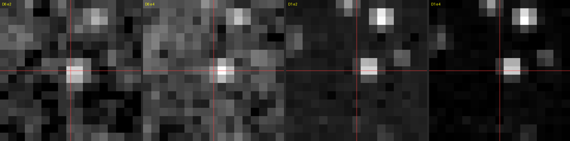

# Relatório de progresso — fases 0 a 2

> Situação em **14/11/2026**, primeiro dia do NASA Space Apps Challenge 2026.
> Desafio: **Planet X and SPHEREx**. Repositório: `enriquessribeiro/spherex-viewer`.

Este relatório consolida o que foi construído até agora, como foi construído e por quê. Os detalhes de cada assunto estão nos documentos de referência ([índice](README.md)); aqui o foco é a história completa e as decisões.

## 1. Resumo executivo

- **O núcleo científico está pronto e validado com dados reais.** O pipeline busca as imagens do SPHEREx no arquivo da NASA (IRSA), alinha todas as exposições numa grade comum, agrupa em épocas e soma, produzindo os quadros que o site vai animar.
- **Os 5 alvos do desafio passam numa validação científica automática** (16 testes) comparando o que o pipeline produz com valores independentes da literatura (SIMBAD, Gaia):

| Alvo | O que a ferramenta mostra |
|---|---|
| WISE 0855 | Anã marrom a 285 K: só aparece em 4–5 µm; move-se ~8″/ano; posição prevista × medida com erro de 0,12–0,19 px |
| Barnard's Star | Move-se **~11″ para o norte em um ano**, medido com erro de ~0,02 px, apesar de saturar o detector |
| Epsilon Indi B | Detectado com folga (S/R 250–640); movimento confere |
| RW Aurigae | Brilho sobe 1,35× entre épocas (12σ) |
| R Draconis | Brilho cai para 0,46× entre épocas (15σ) |
| Estrelas de campo | Ficam paradas entre épocas com variação de 0,02–0,04 px (alinhamento ~25× melhor que um pixel) |

- **Ainda não há interface.** O site (frontend), a API e a publicação são as fases 3 a 5.
- Números: 3 PRs mergeados, 38 commits, 58 testes (42 rápidos + 16 científicos), ~1.600 linhas de Python, 10 documentos.

## 2. Linha do tempo

| Etapa | O que aconteceu | Resultado |
|---|---|---|
| Pesquisa | Leitura do desafio oficial; teste de acesso aos dados do IRSA (TAP + recortes) | Dados do DR1 públicos e acessíveis; recorte lento (~4 MB, ~6 s) |
| Documentação inicial | 01 (projeto), 02 (dados), 03 (arquitetura), 04 (API), 05 (hospedagem), 06 (testes), 07 (plano) | **PR #1** (docs + plano) |
| Fase 0 + Fase 1 | Estrutura do backend, CI e pipeline com dados sintéticos, em 9 fatias de TDD | **PR #2**: 16 testes |
| Fase 2 | Adaptador do IRSA, cache, paralelismo, alvos, Marco 1 e validação científica | **PR #3**: 42 + 16 testes |

## 3. O que foi construído

### 3.1 Estrutura do repositório

```
spherex-viewer/
├── docs/                    ← documentação (este relatório incluso)
│   └── img/                 ← imagens dos resultados (Marco 1)
├── targets.yaml             ← os 5 alvos do desafio (SIMBAD)
├── .github/workflows/
│   └── test.yml             ← CI: testes rápidos em todo PR
└── backend/                 ← Python 3.12, gerenciado com uv
    ├── pipeline/
    │   ├── archive.py       ← interface do arquivo de dados (Exposure, Archive, ArchiveUnavailable)
    │   ├── irsa.py          ← adaptador do IRSA (TAP + recortes + novas tentativas)
    │   ├── cache.py         ← cache em disco de consultas e recortes
    │   ├── field.py         ← o pipeline: build_field (épocas, alinhamento, soma)
    │   └── targets.py       ← alvos e propagação por movimento próprio
    └── tests/
        ├── synthetic.py     ← céu sintético no formato do SPHEREx
        ├── test_pipeline.py, test_irsa_archive.py, test_cache.py, test_targets.py
        ├── fixtures/irsa/   ← respostas reais gravadas do IRSA (WISE 0855)
        └── science/         ← validação científica com dados reais
```

### 3.2 O pipeline, passo a passo

`build_field(ra, dec, fov_arcmin, archive)` é a peça central:

```
consulta ao arquivo ──▶ agrupamento em épocas ──▶ download paralelo dos recortes
        │                                                  │
        ▼                                                  ▼
   NoCoverage se vazio                para cada exposição: subtrai luz zodiacal,
                                      classifica pixels por flags, reprojeta
                                      para a grade do campo (interpolação normalizada)
                                                           │
                                                           ▼
                                      por época e detector: soma ponderada por
                                      1/variância, remove fundo residual, marca
                                      pixels saturados e de baixa qualidade
                                                           │
                                                           ▼
                                      Field: épocas × detectores × quadros,
                                      limites de contraste comuns, exposições que falharam
```

Saída (`Field`):

| Campo | Conteúdo |
|---|---|
| `epochs[i].frames[det]` | `Frame` com `data`, `variance`, `n_exposures`, `background`, `low_quality`, `saturated` |
| `display[det]` | Limites de contraste comuns a todas as épocas do detector |
| `failed_exposures` | Exposições que o IRSA não entregou (puladas) |
| `wcs`, `n` | Grade do campo (TAN, norte para cima, 6,15″/pixel) |

### 3.3 Adaptador do IRSA e cache

- `IrsaArchive.query(ra, dec)`: consulta TAP/ADQL nas coleções `spherex_dr1` e `spherex_qr3`.
- `IrsaArchive.fetch_cutout(...)`: recorte via serviço de cutouts; descarta a extensão EPSF (~4 MB).
- Novas tentativas com espera exponencial (2, 4, 8, 16, 32 s) em `429/5xx`; depois `ArchiveUnavailable`.
- `CachedArchive`: recortes guardados para sempre, consultas por 24 h, escrita atômica.

### 3.4 Alvos

`targets.yaml` tem os 5 alvos com posição e movimento próprio do SIMBAD (época J2000). O centro de cada campo é a posição **propagada até nov/2025** (meio do primeiro ano de dados), para objetos rápidos ficarem perto do centro em todas as épocas.

## 4. Processo de trabalho

### 4.1 Documentação primeiro

Antes de qualquer código, o projeto foi especificado em documentos: objetivo, dados, arquitetura, contrato da API, hospedagem e estratégia de testes. Durante o desenvolvimento, **toda decisão que mudou algo foi registrada no documento correspondente no mesmo PR**.

### 4.2 Fluxo de git

- Um branch por fase (`fase-1/pipeline`, `fase-2/dados-reais`), um PR por fase, `main` só recebe por PR.
- Commits pequenos, um por fatia de TDD, no formato `tipo: descrição`, em português.
- CI (`test.yml`) roda os testes rápidos em todo PR.

### 4.3 TDD com fatias verticais

Cada funcionalidade nasceu de um teste: **teste falhando → código mínimo → teste passando → commit**. Regras que seguimos:

- **Testar pelas interfaces públicas** (`build_field`, `IrsaArchive`, `CachedArchive`, `Target`), nunca por detalhes internos.
- **Valores esperados vindos de fontes independentes**: o que plantamos no céu sintético, literais da especificação (ex.: média ponderada = 2,5) ou catálogos (SIMBAD, Gaia). Nunca recalculando do jeito que o código calcula.
- **Teste que nasce verde é verificado por sabotagem**: quebramos o código de propósito (sem alinhamento, épocas misturadas, `<=` trocado por `<`) e confirmamos que o teste falha.
- **Teste frágil é corrigido, não afrouxado**: ex.: o pico de uma estrela depende de onde a grade cai; passamos a medir o fluxo total, que se conserva.

### 4.4 Sete fronteiras de teste

Definidas antes do código ([06-testes.md](06-testes.md)); até agora implementadas:

| Fronteira | Situação |
|---|---|
| 1. Pipeline com céu sintético | ✅ 27 testes |
| 2. Adaptador do IRSA (respostas gravadas) + cache | ✅ 8 testes |
| 3. API HTTP | Fase 3 |
| 4. Contrato de dados (JSON Schema) | Fase 3 |
| 5. Núcleo do frontend | Fase 4 |
| 6. Validação científica (dados reais) | ✅ 16 testes |
| 7. Ponta a ponta no navegador | Opcional |

## 5. Decisões técnicas

### 5.1 Arquitetura e infraestrutura

| Decisão | Alternativas consideradas | Motivo |
|---|---|---|
| Backend em **Python** (Astropy, reproject, numpy) | — | Ecossistema astronômico; leitura de FITS, WCS e reprojeção prontos |
| **Sem banco de dados**; cache em arquivos | Banco para imagens | Imagens são arquivos; o índice é o próprio IRSA |
| **GitHub Pages** para o site + alvos pré-processados | Vercel | Publicação nativa pelo Actions, sem token; grátis em repo público |
| **Render (free)** para o backend ao vivo | Hugging Face, Fly.io, Railway, Vercel Functions | Único gratuito viável para Python + Astropy (HF restringiu o grátis; Fly/Railway sem plano grátis) |
| **GitHub Actions a cada 3 dias** para atualizar os alvos | Semanal | O cache do Actions expira em 7 dias sem uso |
| Validação científica **bloqueia a publicação** | Só avisar | Site nunca publica dados que falham na ciência; a última versão boa continua no ar |
| Backend entrega **matrizes float32**; contraste, blink, diferença e soma no navegador | Só PNG | Interatividade sem novas requisições; quadros são pequenos (~14 KB) |

### 5.2 Pipeline (várias forçadas pelos dados reais)

| Decisão | Por quê | Como descobrimos |
|---|---|---|
| Pipeline recebe um **adaptador de arquivo** injetável | Testar a ciência com céu sintético; trocar IRSA por cache sem mudar o pipeline | Desenho inicial |
| Recorte de **1,5 × o campo** | Com o detector girado, o recorte precisa cobrir a diagonal (√2) | Teste de alinhamento com rotação |
| **Subtrair `ZODI`** antes de alinhar | `IMAGE` inclui a luz zodiacal | Documentação do produto |
| **Interpolação normalizada** | A bilinear espalhava cada pixel mascarado para ~4 vizinhos | Recorte real: só 91,6% do quadro válido |
| Lista de bits de flags **refeita a partir do cabeçalho real** | A documentação não listava OVERFLOW, SUR_ERROR, NONFUNC, MISSING_DATA | Inspeção de recorte real |
| Flags em **dois níveis** (graves sempre excluídos; suspeitos só se houver alternativa limpa) | Na Barnard's Star, todas as exposições marcam o anel da estrela como suspeito, mas os valores são bons | Barnard's Star aparecia como buraco 3×3, com erro de posição de 1–3 px |
| Valor "limpo" só onde **nenhum** pixel suspeito entra na interpolação | Senão a borda usaria só a asa da estrela e subestimaria o brilho | Teste sintético (fluxo 572 × 628 esperado) |
| Núcleo sem dado marcado como **`saturated`** | O SPHEREx não entrega o núcleo de estrelas muito brilhantes (`NaN` + OVERFLOW) | Barnard's Star |
| Soma ponderada por **1/variância**, com variância propagada | Exposições ruidosas pesam menos; variância alimenta S/R e espectro | Desenho inicial |
| **Fundo residual** removido de cada quadro (mediana com corte sigma) | Desnível de fundo entre épocas dominava a diferença | Marco 1 (diferença em D1 toda azul) |
| Contraste com `vmax` = **máximo**, comum a todas as épocas | Variáveis brilhantes não podem saturar, senão a variação some | Requisito dos alvos variáveis |
| Épocas = grupos com intervalo > **10 dias**, detectados pelos dados | A cobertura real é irregular (WISE 0855: 4 grupos em 1 ano) | Consulta real |
| **4 downloads simultâneos**, 6 tentativas | O IRSA respondeu `503` com só 2 pedidos simultâneos | Gravação das fixtures |
| Exposição indisponível é **pulada e registrada** | Um único `503` persistente derrubou um campo de 258 exposições | Primeira execução do Marco 1 |
| Centro dos alvos = posição **propagada** | O WISE 0855 está ~3,4′ a oeste da coordenada de 2010 do desafio | Comparação com SIMBAD |

### 5.3 Validação científica

| Decisão | Por quê |
|---|---|
| Medidas por **ajuste gaussiano usando só pixels válidos** | O centroide simples tratava o núcleo saturado como zero e criava uma tendência falsa de 0,3 px/ano na Barnard's Star |
| Tolerâncias **calibradas com dados reais e justificadas** | Posição < 0,5 px; deslocamento < 0,25 px; estrelas paradas < 0,3 px (observado bem abaixo) |
| Astrometria só em épocas com **S/R ≥ 5** | Épocas com poucas exposições (WISE 0855 época 1, S/R 3) são marginais |
| Variáveis por **fotometria relativa** às estrelas de campo, com dispersão **robusta (MAD)** | Cancela diferenças de calibração entre épocas; uma estrela de campo variável não infla o critério |
| Estrelas de campo a **> 12 px** do alvo, com ajuste válido em todas as épocas | O halo do R Draconis estava sendo usado como "estrela de campo" |
| Controles negativos: **alvo é o objeto mais variável do campo**; **≤ 20%** das estrelas de campo parecem variáveis | Algumas estrelas de campo variam de verdade (4/36); o limite foi definido após a observação e está registrado como tal |

## 6. Problemas encontrados e como foram resolvidos

| # | Problema | Causa | Solução | Fase |
|---|---|---|---|---|
| 1 | Teste do pico de estrela falhava (77,9 × 100) | Recorte com nº par de pixels: centro entre 4 pixels | Medir fluxo total, não pico | 1 |
| 2 | `503 Server busy` do IRSA | Servidor ocupado | Novas tentativas com espera exponencial; paralelismo limitado | 2 |
| 3 | Bits de flag inesperados | Documentação incompleta | Lista refeita do cabeçalho real | 2 |
| 4 | Só 91,6% do quadro real válido | NaN espalhado pela interpolação | Interpolação normalizada | 2 |
| 5 | Campo inteiro falhou após 115 downloads | Um `503` persistente | Pular e registrar a exposição | 2 |
| 6 | Diferença entre épocas dominada pelo fundo | Resíduo da luz zodiacal | Remoção do fundo residual | 2 |
| 7 | Barnard's Star como buraco 3×3 | Anel suspeito + núcleo sem dado | Flags em dois níveis + `saturated` | 2 |
| 8 | Tendência falsa no movimento da Barnard | Centroide simples com núcleo NaN | Ajuste gaussiano (no teste) | 2 |
| 9 | Variáveis reprovadas | Halo do R Dra usado como comparação; desvio padrão inflado | Raio de exclusão + MAD (no teste) | 2 |
| 10 | Controle negativo reprovado | Estrelas de campo que variam de verdade | Controle reformulado | 2 |
| 11 | Separação ε Indi A–B escrita como 1,5′ | Erro de memória | Calculado: 6,7′; campo de 6′ centrado no B | 2 |

## 7. Resultados

Detalhes, tabelas e imagens em [08-resultados.md](08-resultados.md).



*WISE 0855: em D6 (dois primeiros painéis) a anã marrom se desloca ~1 px para a direita (oeste) entre nov/2025 e mai/2026; em D1 (dois últimos) ela não aparece e a estrela de fundo fica parada.*

Achados com valor para a apresentação:

- A ferramenta **reproduz o movimento próprio conhecido** de três objetos próximos (WISE 0855, Barnard's Star, ε Indi B) com erro de centésimos a décimos de pixel.
- **Detecta variabilidade** das duas estrelas variáveis do desafio com alta significância.
- **Revelou estrelas de campo que parecem variar e não estão catalogadas como variáveis**, incluindo uma provável estrela jovem associada a uma fonte de raios X em Taurus: exatamente o tipo de descoberta que o desafio quer viabilizar.

## 8. Limitações conhecidas

- **Variabilidade por quadro de detector é aproximada**: o quadro soma exposições em comprimentos de onda diferentes (filtro de variação linear). A análise rigorosa compara espectros (espectro sob demanda, fase 6).
- **Pixel grande (6,15″)**: movimentos de alguns ″/ano são sutis (~1 px/ano); o site precisa de zoom, blink e mira fixa.
- **Épocas com poucas exposições** são ruidosas (ex.: WISE 0855 em mai/2025).
- **`WCS-WAVE` é "para visualização"** segundo a documentação do SPHEREx; suficiente para o espectro do site, não para ciência de precisão.
- **Primeiro download é lento** (~60 min para os 5 alvos), por causa da extensão PSF que o IRSA sempre envia. Execuções seguintes usam o cache.
- **SIMBAD principal (CDS) estava fora do ar**; usado o espelho de Harvard.

## 9. Próximos passos

| Fase | Entrega |
|---|---|
| **3 — Saídas e API** | `field.json` + quadros `.f32`/`.png` validados por JSON Schema; `build_static` (dados dos 5 alvos); API FastAPI (`/field` assíncrono, `/resolve`, erros, CORS) |
| **4 — Frontend** | `viewer-core` com TDD; player, blink, diferença, seletor de detector; **Marco 2: site funcionando com dados estáticos** |
| **5 — Publicação** | Action a cada 3 dias (pipeline → validação científica → Pages); API no Render |
| **6 — Extras** | Espectro sob demanda; Aladin Lite com Gaia/WISE e posição prevista; overlay de flags; falsa cor; campo variável; embed; roteiro do pitch |

Lições já registradas para o frontend: abrir em **D6** para anãs marrons frias, diferença padrão entre as épocas com **mais sinal**, núcleo saturado pintado com o **brilho máximo**, zoom e mira fixa para movimentos de ~1 px.
