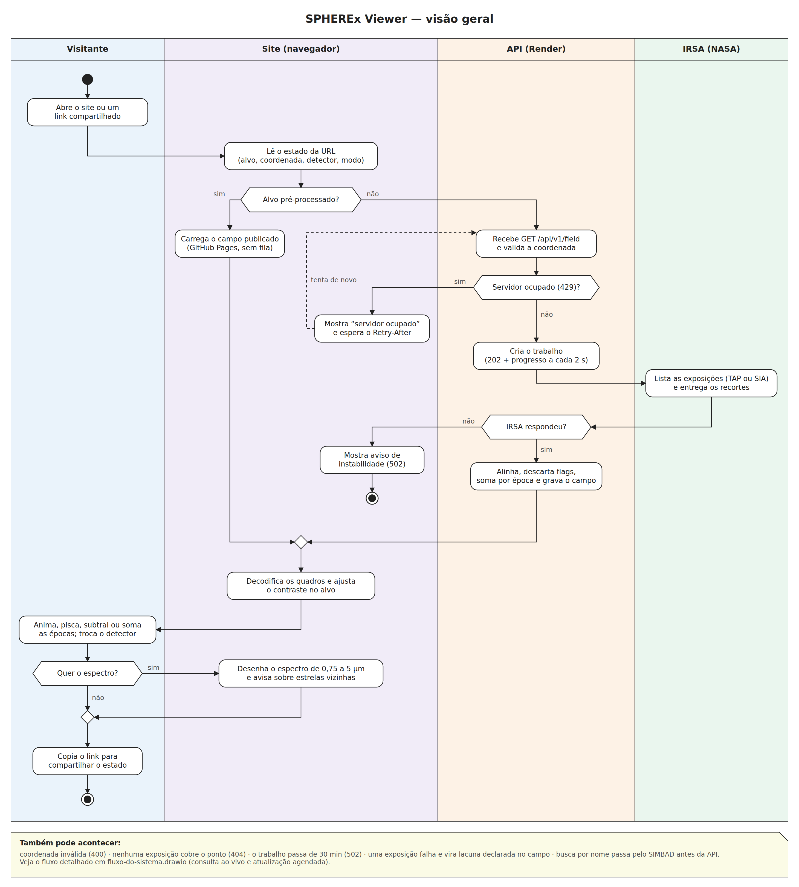
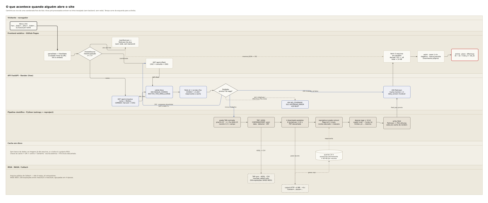

# Fluxo do sistema — diagramas

## Visão geral (diagrama de atividade)

Uma página só, para quem chega agora: o que o visitante faz, o que o site, a API e o IRSA fazem
em resposta, e as decisões no caminho (alvo pré-processado? servidor ocupado? IRSA respondeu?).

[](atividade-visao-geral.png)

| Arquivo | O que é |
|---|---|
| [`atividade-visao-geral.puml`](atividade-visao-geral.puml) | Fonte editável em PlantUML |
| [`atividade-visao-geral.svg`](atividade-visao-geral.svg) | O mesmo desenho em vetor |
| [`atividade-visao-geral.png`](atividade-visao-geral.png) | PNG em 2× (2920×3240) |
| [`visao-geral.py`](visao-geral.py) | Desenha o SVG e o PNG |

O projeto não depende de Java, então o PNG não sai do PlantUML: o `visao-geral.py` desenha o
mesmo diagrama no estilo do PlantUML (raias coloridas, caixas arredondadas, losangos sim/não) com
a biblioteca padrão e rasteriza com o Chrome headless, como o `para-png.py`:

```bash
python3 docs/diagramas/visao-geral.py          # SVG + PNG
plantuml docs/diagramas/atividade-visao-geral.puml   # alternativa, se tiver o PlantUML
```

Ao mudar um passo, mude o `.puml` e a lista de passos do `visao-geral.py`. Os casos que não
cabem na visão geral estão na nota do rodapé e no diagrama detalhado abaixo.

## Fluxo detalhado (diagrama de raia)

Análise do caminho completo de uma requisição, do clique no navegador até o pixel na tela, e do
caminho paralelo que mantém os alvos prontos antes de alguém pedir. O desenho está em
[`fluxo-do-sistema.drawio`](fluxo-do-sistema.drawio), três páginas, editável.

Complementa [03-arquitetura.md](../03-arquitetura.md) (fluxo narrativo), [04-api.md](../04-api.md)
(contrato) e [05-hospedagem.md](../05-hospedagem.md) (infraestrutura). Aqui o assunto é
**quem faz o quê, em que ordem, e o que acontece quando algo falha**.

## 1. Abrir e editar

| Como | Passo |
|---|---|
| Navegador | [app.diagrams.net](https://app.diagrams.net) → *Open Existing Diagram* → escolher o `.drawio` |
| VS Code | extensão **Draw.io Integration**, abrir o arquivo direto |
| Desktop | draw.io / diagrams.net, *File → Open* |

O arquivo tem três páginas, navegáveis na parte de baixo da janela:

1. **Consulta ao vivo** — o caminho que roda hoje, quando alguém abre o site.
2. **Atualização agendada** — o robô da fase 5. **Bordas tracejadas significam "ainda não
   existe"**: hoje o repositório só tem o `test.yml`.
3. **Legenda e números** — o vocabulário visual e as medidas reais que explicam o desenho.

O `.drawio` é gerado por script, não desenhado à mão:

```bash
python3 docs/diagramas/gerar.py     # reescreve fluxo-do-sistema.drawio ao lado
```

### PNG

Se só precisa da imagem, os três arquivos abaixo já estão aqui — gerados do `.drawio`, em 2×:

| Página | Arquivo |
|---|---|
| Consulta ao vivo | [`01-consulta-ao-vivo.png`](01-consulta-ao-vivo.png) (6900×2880) |
| Atualização agendada | [`02-atualizacao-agendada.png`](02-atualizacao-agendada.png) (6900×3220) |
| Legenda e números | [`03-legenda-e-numeros.png`](03-legenda-e-numeros.png) (2200×1440) |



Não é screenshot: o viewer do diagrams.net entrega cada página como um `<svg>` em
coordenadas de modelo, e esse SVG é rasterizado com o tamanho exato da página. Por isso o
texto sai vetorial e qualquer escala funciona.

```bash
python3 docs/diagramas/para-png.py --scale 2
```

Precisa de um Chrome/Chromium headless no `PATH` (ou `CHROME_BIN`). **Não** precisa do app do
draw.io.

O gerador usa só a biblioteca padrão e calcula todas as coordenadas (raias de altura fixa, colunas
de passo 240 px, âncoras explícitas nas arestas). Mudar o texto de um nó ou mover uma raia é editar
uma linha em Python e rodar de novo — em vez de arrastar 52 KB de XML. Se preferir editar no
draw.io, edite: nada se perde, mas o próximo `gerar.py` sobrescreve. Nesse caso, mude o script.

## 2. Atores e fronteiras

Seis raias na página 1, sete na página 2. As fronteiras que importam:

| Raia | O que possui | Confiança |
|---|---|---|
| **Visitante** | Um link: `?ra=…&dec=…&fov=…&det=…`. Nada é armazenado numa conta — o estado mora na URL | não confiável |
| **Frontend estático** (GitHub Pages) | HTML/JS, `data/manifest.json` e os campos pré-processados. Decodifica `.f32`/`.u8`, faz contraste, blink, diferença | público |
| **API FastAPI** (Render) | Validação, `field_id`, fila de trabalhos, entrega do `field.json` | público, sem autenticação |
| **Pipeline científico** (Python) | Consulta ao arquivo, download, reprojeção, cobertura, limites de contraste | roda no servidor |
| **Cache em disco** | Recortes e resultados de consulta. **Não há banco de dados** | local ao processo |
| **IRSA** (NASA/Caltech) | Arquivo público das imagens. Não é nosso: consumimos | externo, instável (`503 Server busy`) |

Duas consequências de haver uma única fronteira de dados, e não duas:

- O frontend **não sabe** de onde veio um campo. `chooseSource` devolve `static`, `api` ou
  `resolve`, e depois disso o código é o mesmo (`loadFrame`, `decodeF32`, render).
- O trabalho pesado fica no servidor; o interativo fica no navegador. Um quadro de 6′ é uma matriz
  `60×60` float32 → **~14 KB**. Trocar de época, piscar, somar, subtrair: zero requisições.

## 3. Caminho ao vivo, passo a passo

O que a página 1 desenha, com o arquivo responsável por cada passo.

**1. Abre o link.** `parseState` (em `frontend/src/core/state.ts`) converte a query string num
`ViewState`. Link compartilhável e modo embed saem de graça, porque o estado já está na URL.

**2. Escolhe a fonte.** `chooseSource` (`core/source.ts`) decide em três perguntas, nesta ordem:

| Situação | Resultado |
|---|---|
| `?target=wise0855` e o id existe no manifesto | `static` — `data/fields/…/field.json` |
| Coordenada a menos de **1″** de um alvo (mesmo `fov`) | `static` — mesma tolerância para RA corrigida por `cos(dec)` |
| Coordenada fora da lista | `api` — `GET /api/v1/field?ra=…` |
| `?name=…` | `resolve` — o backend pergunta ao SIMBAD |
| Nada disso, e sem API configurada | `unavailable` — mensagem, não erro de rede |

**3. Backend valida.** Faixa de RA/Dec (`400 INVALID_COORDS`), tamanho do campo
(`400 FOV_TOO_SMALL` / `FOV_TOO_LARGE`). Números que não são números caem em `400 INVALID_PARAM`.

**4. Identidade do campo.** `field_id` combina RA + Dec + fov quantizados. É a chave de cache e de
fila: dois visitantes no mesmo campo compartilham o mesmo trabalho.

**5. Fila.** `FieldJobs` responde na hora: **202** com `stage` e `progress.done/total`, e o frontend
consulta a cada `poll_after_ms` (2000 ms). Trabalhos simultâneos: 2 por padrão
(`SPHEREX_MAX_JOBS`). Acima disso, `429 BUSY` com `Retry-After: 30`.

**6. Pipeline.** `build_field` (`backend/pipeline/field.py`):

- grade TAN centrada na coordenada, pixel de 6,15″;
- consulta TAP/ADQL ao IRSA (`CONTAINS(POINT, poly)`), uma vez por campo, cacheada 24 h;
- recorte de **1,5 × o campo** — cobre a diagonal (√2 ≈ 1,41) sem perder borda;
- até **4 downloads simultâneos**, 6 tentativas com espera exponencial (2–32 s), extensão EPSF
  descartada (~4 MB por recorte, não usada);
- reprojeção para a grade comum com interpolação **normalizada** (imagem e máscara de pixels
  válidos reprojetados e divididos);
- flags em **dois níveis**: cinco bits graves sempre excluídos; quatro bits suspeitos excluídos só
  se outra exposição tiver o ponto limpo — senão usados e marcados `low_quality`;
- épocas por lacuna de **10 dias**; cobertura ponderada por `1/var²`, fundo residual removido
  (mediana 3σ) e guardado; limites de contraste `vmin` = percentil 1, `vmax` = máximo, comuns a
  todas as épocas.

**7. Entrega.** `200` com `field.json` (`Cache-Control: 1 h`, `data_version` imutável). O frontend
busca o quadro em três arquivos paralelos — valor, variância, máscara — e decodifica. A partir
daí, tudo é cliente.

**8. Resultado.** `asinh`, negativo, zoom 1–4×, marca da posição prevista pelo movimento próprio,
e os três modos de comparação. A diferença é `(b − a) / √(var_a + var_b)`: em **unidades de
ruído**, não em ADU. É o que faz o céu parado desaparecer e sobrar só o que mudou.

## 4. A máquina de estados do trabalho

A parte que mais confunde quem lê o código pela primeira vez: **o mesmo endpoint é o pedido e a
consulta de progresso**.

```
        ┌──────────── wait (429 BUSY, Retry-After: 30)
        │
GET /field ──▶ field_id ──▶ job existe e está pronto? ──sim──▶ 200 field.json
                                 │não
                                 ▼
                          há vaga na fila? ──não──┐
                                 │sim            │
                                 ▼               │
                          cria o trabalho ───────┘
                                 │
                                 ▼
                          202 {stage, progress, poll_after_ms}
                                 │        ▲
                    (o trabalho roda)     │ o frontend consulta a cada 2 s
                                 ▼        │
                      querying → downloading → ready | error
                                                  │
                                     erro conhecido? ──▶ 404 NO_COVERAGE
                                                        │  502 UPSTREAM_ERROR
                                                        └─ 500 INTERNAL
```

`stage` é `querying`, `downloading`, `ready` ou `error`. Depois de `ready`, o `field.json` fica em
disco e o pedido seguinte é `200` direto, sem fila.

## 5. Caminho agendado (página 2)

A página 2 foi desenhada antes da fase 5 e usa borda tracejada para "ainda não existe". **Hoje
tudo existe**: o `update-data.yml` roda a cada 3 dias e a cada merge na `main` que mexe no
código, e publicou com sucesso depois que o IRSA voltou (14/11/2026). Quando o IRSA inteiro cai,
o `publish-snapshot.yml` (manual) publica dados gerados e validados localmente.

O gatilho é `cron 0 6 */3 * *` (a cada 3 dias, 6 h UTC — intervalo escolhido porque o GitHub
apaga cache sem uso há 7 dias). O runner faz `checkout` + `setup-python` + `restore actions/cache`,
chama `build_static --targets targets.yaml` para os 5 alvos, roda `pytest -m science` e só então
publica: `manifest.json` → `upload-pages-artifact` → `deploy-pages`.

Dois pontos de desenho que valem o comentário:

- **A validação científica é um portão, não um relatório.** Se `pytest -m science` falha, o deploy
  não acontece. O pipeline é o mesmo da API — `build_static` chama `build_field` —, o que garante
  que o dado pré-processado e o dado ao vivo não divirjam.
- **O cache é o que torna o cron barato.** Primeira execução: ~1.950 recortes, ~60 min. Com o cache
  quente: consulta + exposições novas, 1–3 min.

## 6. O que o desenho deixa de fora

Simplificações conscientes, para o diagrama caber numa tela e continuar legível:

| Fora do desenho | Onde está |
|---|---|
| `/api/v1/health`, `/api/v1/config` | `backend/api/app.py` |
| `/api/v1/fields/{path}` — serve os binários do campo | `backend/api/app.py` |
| Espectro dos alvos (`spectrum.json`), falsa cor, soma, flags | fase 6 — `pipeline/spectrum.py`, `src/ui/spectrum.ts`, `src/core/render.ts` |
| Mapa do céu (Aladin Lite) + Gaia/AllWISE | fase 6 — `src/ui/skymap.ts` |
| `unavailable` do `chooseSource` (sem manifesto e sem API) | `core/source.ts` |
| Ramo de ligação entre `field_id` e o cache de renders | `backend/pipeline/cache.py` |

## 7. Falhas e o que o sistema faz

| Falha | Resposta | Efeito para o visitante |
|---|---|---|
| Coordenada fora de faixa | `400 INVALID_COORDS` | erro imediato, sem trabalho criado |
| `fov` acima/abaixo do limite | `400 FOV_TOO_SMALL` / `FOV_TOO_LARGE` | idem |
| Nenhuma exposição cobre o ponto | `404 NO_COVERAGE` | "não há dados aqui", não é bug |
| IRSA responde `503` em todas as tentativas | `502 UPSTREAM_ERROR` | mensagem de instabilidade |
| Fila cheia | `429 BUSY` + `Retry-After: 30` | o site mostra "servidor ocupado", espera e repete |
| Trabalho passa de 30 min | `502 UPSTREAM_ERROR` (`SPHEREX_JOB_TIMEOUT_S`) | mensagem; o próximo pedido começa de novo |
| **Uma** exposição indisponível | é pulada, entra em `failed_exposures` | campo completo, com uma lacuna declarada |
| Erro transitório do IRSA | nada é memorizado | o próximo pedido tenta de novo |
| Alvo estático ausente e sem API | `unavailable` | o site abre, mas sem dados daquele ponto |

A regra que aparece em três lugares diferentes do código e vale registrar: **um erro transitório
não pode virar dado permanente**. Por isso a consulta é cacheada por 24 h (e não para sempre) e a
exposição que falhou não é gravada.

## 8. Ordem de grandeza

Números medidos com os 5 alvos reais, não estimativas de projeto:

| Medida | Valor |
|---|---|
| Exposições do WISE 0855 | 258, entre mai/2025 e mai/2026, em 4 épocas |
| Um recorte do IRSA | ~4 MB, ~6 s (~95% é a extensão PSF, descartada) |
| Cache de um recorte | ~60 KB (~370 MB para 1.950) |
| Quadro entregue ao navegador | `60×60` float32 ≈ 14 KB |
| Pixel do SPHEREx | 6,15″ — Barnard's Star anda ~1,5–2 px por semestre |
| Primeira execução do Action | ~60 min |
| Execução com cache quente | 1–3 min |
